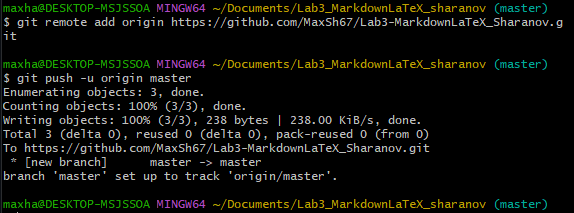

# Лабораторная работа №3. Работа с Markdown-разметкой и базовое использование LaTeX в документации проекта

В ходе этой лабораторной работы я познакомился с языком разметки Markdown и базовыми возможностями LaTeX. Я научился создавать заголовки, списки, таблицы, вставлять изображения, оформлять блоки кода и математические формулы. Также я настроил Git-репозиторий и загрузил проект на GitHub. Полученные навыки пригодятся мне для оформления документации и README-файлов в будущих проектах.

---

## Содержание

- [Структура проекта](#структура-проекта)
- [Элементы Markdown](#элементы-markdown)
  - [Заголовки](#заголовки)
  - [Форматирование текста](#форматирование-текста)
  - [Списки](#списки)
  - [Цитата](#цитата)
  - [Блок кода](#блок-кода)
  - [Таблица](#таблица)
  - [Изображение](#изображение)
  - [Ссылки](#ссылки)
  - [Чекбоксы](#чекбоксы)
  - [Сноска](#сноска)
  - [Alert-блоки GitHub](#alert-блоки-github)
  - [Inline LaTeX](#inline-latex)
  - [Block LaTeX](#block-latex)

---

## Структура проекта
- Lab3_MarkdownLaTeX_Sharanov
  - docs
    - advancedMarkdownLab3_Sharanov.md
    - codeQuotesLab3_Sharanov.md
    - formattingLab3_Sharanov.md
    - headersLab3_Sharanov.md
    - latexLab3_Sharanov.md
    - linksImagesLab3_Sharanov.md
    - listsLab3_Sharanov.md
    - ReadmePushLab3_Sharanov.md
    - separatorsLab3_Sharanov.md
    - tablesLab3_Sharanov.md
  - img
  - latex
  - FormatDemo.cs
  - README.md

---

## Элементы Markdown

### Заголовки

В Markdown заголовки создаются с помощью символа `#`.

# Пример заголовка H1

## Пример заголовка H2

### Пример заголовка H3

---

### Форматирование текста

- **Полужирный текст** - `**текст**`
- *Курсив* - `*текст*`
- ~~Зачёркнутый~~ - `~~текст~~`
- `Моноширный` - `` `текст` ``

---

### Списки

#### Маркированный список

- Первый пункт
- Второй пункт
- Третий пункт

#### Нумерованный список

1. Первый пункт
2. Второй пункт
3. Третий пункт

#### Вложенный список

1. Основной пункт
   - Подпункт первого уровня
     - Подпункт второго уровня
2. Второй основной пункт

---

### Цитата

> Цитата в Markdown.
> > Вложенная цитата.

---

### Блок кода

Пример блока кода с указанием языка:

```csharp
class Program
{
    static void Main()
    {
        Console.Write("Введите первое число: ");
        double number1 = Convert.ToDouble(Console.ReadLine());
        
        Console.Write("Введите второе число: ");
        double number2 = Convert.ToDouble(Console.ReadLine());
        
        double sum = number1 + number2;
        Console.WriteLine($"Результат: {sum}");
    }
}
```

### Таблица
|1|2|3|
|-|-|-|
|4|5|6|
|7|8|9|

---

### Изображение из папки img/


---

### Ссылка
[Markdown Guide](https://www.markdownguide.org/ "Перейти на официальный сайт")
[Перейти к коду](#блок-кода)

---

### чекбоксы
- [x] Учить 
- [ ] Не учить

---

### Сноска
Markdown полезен в разработке[^markdown].
[^markdown]: Markdown — лёгкий язык разметки.

---

### Alert-блоки GitHub

> [!NOTE]
> Просто заметка. В Markdown есть специальные блоки для выделения текста.

> [!TIP]
> Совет: чтобы посмотреть, как выглядит Markdown в VS Code, нажми Ctrl+Shift+V.

> [!IMPORTANT]
> Важно знать: GitHub умеет показывать формулы LaTeX.

> [!WARNING]
> Внимание: не забывай пушить.

---

### Inline LaTeX
Площадь круга вычисляется по формуле $S = \pi r^2$.

---

### Block LaTeX
Степени и индексы: $x^2, a_i, x^{10}$

Дроби: $\frac{a}{b}$

Корни: $\sqrt{x}, \sqrt[3]{y}$

Греческие буквы: $\alpha, \beta, \gamma, \delta$

Суммы и произведения: $\sum_{i=1}^n i, \prod_{k=1}^n k$

Матрицы: 
$$
\begin{pmatrix} 1 & 2 \\ 3 & 4 \end{pmatrix}
$$